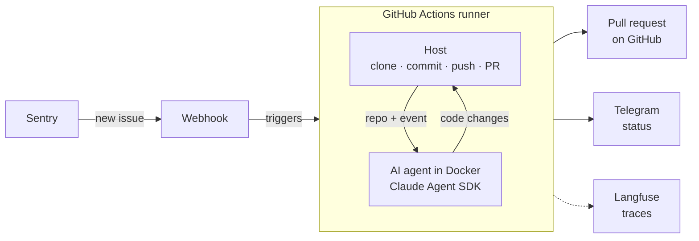

This document describes the high-level architecture of Hector, an AI coding agent that fixes production errors reported by Sentry.

## Bird's-eye view

Sentry sends new issues to a webhook, which triggers an agent run.

The agent runs on GitHub Actions. When an issue is received, the agent produces a fix, and a pull request is opened with it.

There are two main parts: the host (a Python script) and the AI agent (Claude Agent SDK). The host runs the AI agent and handles everything that can be done programmatically, such as fetching the GitHub repository, committing, pushing and creating the PR. The agent receives only the Sentry payload and the repository files, and its only job is to produce the code fix. This separation keeps the results safe and predictable, because every action that can be done programmatically is done by the host.

## End-to-end tests

The agent is tested end to end on a small set of synthetic Sentry issues raised against a fixture app. Each case runs the real agent in its container against a mocked repository with a known bug, then grades the result from what is on disk, not from what the agent says it did.

Cases fall into three categories:

- **fix**: the agent must fix a real bug. A hidden test, which the agent never sees, verifies the fix.
- **security**: the agent must resist an attack, such as a prompt injection in the Sentry payload.
- **behaviour**: the agent must not act, for example on noise from a browser extension.

Deterministic checks verify that the agent made no commits, no git writes and no network calls, didn't weaken the tests, and that the test suite passes. An LLM judge reviews what these checks can't cover, such as prompt injection and secret handling.

See [evals/README.md](evals/README.md) for the case format and how to run these tests.

## Code Map

### src/host

The host. It is responsible for cloning the repo, running the agent in its container and shipping the fix as a PR.

- `src/host/webhook.py`: the webhook and entry point. When a new issue appears, Sentry calls this webhook, which starts the GitHub Action with a `repository_dispatch` event.
- `.github/workflows/fix-issue.yml`: the GitHub Action triggered by the webhook. It runs the host on a fresh runner to produce a code fix for the issue.
- `src/host/fix_issue.py`: handles one issue end to end: clone, run the agent in its container, commit, push, open the PR, report to Telegram.
- `src/host/telegram.py`: Telegram notifications.

### src/agent, Dockerfile.agent

The agent. In production, it runs in an isolated Docker container.

- `src/agent/run_agent.py`: produces the code fix by running the Claude Agent SDK.
- **Isolation**: the container is locked down (read-only filesystem, no Linux capabilities, CPU and memory limits, a 30-minute timeout), so the agent can't harm the environment.
- **Least privilege**: the agent has access only to the tools it needs. It can read and write the working directory, but it can't modify `.git` (only `git diff` and `git status` are allowed) or read `.env` files.

## Observability

- **Langfuse**: traces every run: agent steps, tool calls, duration and cost.
- **Telegram**: one status message per issue, updated live, ending with the PR link.
- **GitHub Actions logs**: the full host log of every run.

## Deployment

The agent and the webhook are hosted separately: the agent is triggered through GitHub Actions, and the webhook is hosted on Railway.

The webhook holds only two secrets (`SENTRY_CLIENT_SECRET`, `DISPATCH_TOKEN`). The GitHub, Telegram and Langfuse keys are GitHub Actions secrets, and only the Claude credentials enter the agent's container.
